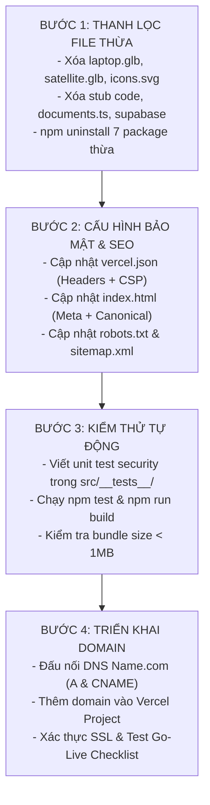

# ĐẶC TẢ KỸ THUẬT: THANH LỌC CODEBASE, KIỂM THỬ BẢO MẬT & TRIỂN KHAI PRODUCTION DOMAIN TRANVANTUYEN.DEV

- **Tài liệu:** `docs/specs/clean-security-deployment-spec.md`
- **Dự án:** `portfolio-web` (Portfolio Cá Nhân Trần Văn Tuyên — Creative Developer & 3D Web Designer)
- **Tác giả:** Product Architect & UX Specifier (`autonomous-dev` team)
- **Phiên bản:** 1.0 (Production Architecture Edition)
- **Ngày lập:** 23/10/2026
- **Trạng thái:** **PHÊ DUYỆT & CHỐT THI CÔNG** (Approved for Execution)
- **Phạm vi áp dụng:** Senior Dev, DevOps Engineer, QA/Security Tester

---

## MỤC LỤC
1. [TỔNG QUAN & BỐI CẢNH KIẾN TRÚC HIỆN TẠI](#1-tổng-quan--bối-cảnh-kiến-trúc-hiện-tại)
2. [KHẢO SÁT TOÀN BỘ CODEBASE & MA TRẬN THANH LỌC FILE THỪA](#2-khảo-sát-toàn-bộ-codebase--ma-trận-thanh-lọc-file-thừa)
   - 2.1. Phân loại cấu trúc thư mục hiện tại
   - 2.2. Danh mục tài sản tĩnh & 3D models thừa cần xóa ngay (Tiết kiệm ~9.6 MB)
   - 2.3. Danh mục mã nguồn thừa / stub không dùng đến trong `src/`
   - 2.4. Danh mục gói phụ thuộc thừa trong `package.json`
   - 2.5. Xử lý tài liệu và đặc tả cũ (`docs/` & `docs/specs/`)
   - 2.6. Bảng tổng hợp hành động dọn dẹp (Action Items Matrix)
3. [KẾ HOẠCH TEST TOÀN DIỆN BẢO MẬT (FULL SECURITY TESTING PLAN)](#3-kế-hoạch-test-toàn-diện-bảo-mật-full-security-testing-plan)
   - 3.1. Mô hình phân tích đe dọa (Threat Modeling - STRIDE cho Static SPA)
   - 3.2. Kiểm thử chống Cross-Site Scripting (XSS) & DOM-based Injection
   - 3.3. Đặc tả Content Security Policy (CSP Level 3) cho Vite + Three.js + WebGL
   - 3.4. Phòng chống Clickjacking & UI Redressing (`X-Frame-Options` & `frame-ancestors`)
   - 3.5. Kiểm soát Referrer Policy & Ngăn rò rỉ dữ liệu phiên
   - 3.6. Subresource Integrity (SRI) & Quản trị tài nguyên CDN bên thứ ba
   - 3.7. Chuẩn hóa HTTPS, TLS 1.3 và HSTS cho TLD `.dev`
   - 3.8. Kiểm tra rò rỉ biến môi trường và Secret Scanner
   - 3.9. Ma trận tiêu đề bảo mật HTTP (Security Headers Matrix) cho `vercel.json`
   - 3.10. Kịch bản kiểm thử tự động với Vitest (Automated Security Test Suite)
4. [KẾ HOẠCH TRIỂN KHAI DOMAIN TRANVANTUYEN.DEV (PRODUCTION DEPLOYMENT BLUEPRINT)](#4-kế-hoạch-triển-khai-domain-tranvantuyendev-production-deployment-blueprint)
   - 4.1. Kiến trúc phân giải tên miền (DNS Architecture)
   - 4.2. Bảng cấu hình bản ghi DNS (DNS Records Matrix)
   - 4.3. Quản lý chứng chỉ số SSL/TLS Certificate & Gia hạn tự động
   - 4.4. Cấu hình Vercel Production (`vercel.json` hoàn chỉnh)
   - 4.5. Chuẩn hóa SEO, Robots.txt, Sitemap.xml & Canonical URLs
   - 4.6. Tối ưu hóa thẻ Meta xã hội (OpenGraph & Twitter Card) trong `index.html`
   - 4.7. Quy trình CI/CD GitHub Actions & Tự động triển khai
   - 4.8. Danh mục kiểm tra nghiệm thu triển khai (Production Go-Live Checklist)
5. [LỘ TRÌNH THỰC THI (ACTIONABLE ROADMAP)](#5-lộ-trình-thực-thi-actionable-roadmap)

---

## 1. TỔNG QUAN & BỐI CẢNH KIẾN TRÚC HIỆN TẠI

### 1.1. Bối cảnh dự án
Dự án **`portfolio-web`** của **Trần Văn Tuyên** (sinh năm 2005, sinh viên CNTT Đại học Thủy Lợi - TLU) đã trải qua quá trình tái cấu trúc toàn diện sang kiến trúc **Single Page Application (SPA) Đồ họa 3D Tương tác cao cấp** lấy cảm hứng từ studio danh tiếng thế giới **Lusion.co**:
- Trọng tâm giao diện: Khối cầu hạt hữu cơ 3D (**Organic Sphere Wireframe Mesh**) tương tác thời gian thực bằng **Three.js** và **Custom GLSL Simplex Noise Shader**.
- Trải nghiệm thị giác: Đạt chuẩn mượt mà 60 FPS, hệ thống âm thanh phản hồi xúc giác (**Procedural Web Audio SFX Synthesizer**), phong cách thẩm mỹ Light Mode thanh lịch không rập khuôn AI (*Anti-AI Slop*).
- Luồng thông tin trang chủ tập trung vào 5 phân vùng duy nhất:
  1. `HeroSection`: Điểm chạm thị giác 3D GLSL, tuyên ngôn định vị Creative Developer.
  2. `ProjectsSection`: Showcase các dự án tiêu biểu dạng thẻ tương tác 3D Parallax Tilt kèm bản vẽ giải phẫu kiến trúc SVG.
  3. `CapabilitiesSection`: 4 trụ cột kỹ thuật cốt lõi với hiệu ứng mở từ chiều sâu (3D Spatial Unfold).
  4. `AboutSection`: Tiểu sử, triết lý thiết kế và cột mốc học tập tại ĐH Thủy Lợi.
  5. `FooterSection`: Kêu gọi kết nối, tương tác ánh sáng Spotlight động, sao chép email 1 chạm và liên kết GitHub.

### 1.2. Vấn đề tồn đọng sau các đợt phát triển lặp (Iterative Refactoring)
1. **Dung lượng build bị phình to bất thường (~10.4 MB)**: Hai mô hình 3D cũ (`laptop.glb` 5.46 MB và `satellite.glb` 4.11 MB) từ các bản thiết kế trước vẫn nằm trong thư mục `public/assets/models/`, bị Vite tự động đóng gói nguyên vẹn vào `dist/` mà hoàn toàn không có dòng code nào sử dụng!
2. **Mã nguồn rác và file dummy**: Các component rỗng (`CustomCursor.tsx`, `LabsSection.tsx`), file dữ liệu cũ (`documents.ts`), file cấu hình Supabase (`supabaseClient.ts`, `database.ts`, `service.ts`, `supabase/migrations/`) bị bỏ rơi sau khi loại bỏ backend phức tạp.
3. **Phụ thuộc NPM dư thừa**: Các thư viện nặng như `@mui/material`, `@emotion/*`, `react-router-dom`, `react-icons`, `react-helmet-async`, `@supabase/supabase-js` vẫn được liệt kê trong `package.json` gây tốn tài nguyên cài đặt và tiềm ẩn lỗ hổng chuỗi cung ứng.
4. **Cấu hình tên miền & SEO lệch lạc**: `sitemap.xml` và `robots.txt` vẫn chứa các đường dẫn trang cũ (`/portfolio`, `/resources`, `/admin`), trong khi `vercel.json` thiếu toàn bộ tiêu đề bảo mật HTTP thiết yếu.
5. **Chứng chỉ & Tên miền `tranvantuyen.dev`**: Đã được đăng ký tại Name.com (hạn 2027) nhưng chưa có tài liệu hướng dẫn đấu nối DNS, thiết lập SSL/TLS và quy trình xác thực tự động.

---

## 2. KHẢO SÁT TOÀN BỘ CODEBASE & MA TRẬN THANH LỌC FILE THỪA

### 2.1. Phân loại cấu trúc thư mục hiện tại
Qua khảo sát toàn diện hệ thống tệp tin tại `G:\webCaNhan\portfolio-web`, cấu trúc dự án bao gồm:
```
portfolio-web/
├── docs/                        # 8 tài liệu kiến trúc v4.0 (20/10/2026)
│   └── specs/                   # 6 tài liệu đặc tả thiết kế cũ
├── public/                      # Static assets phục vụ trực tiếp bởi Vite
│   ├── assets/models/           # CHỨA 2 FILE GLB KHỔNG LỒ KHÔNG DÙNG (9.57 MB)
│   ├── favicon.svg              # Đang dùng (index.html)
│   ├── icons.svg                # File SVG sprite cũ không dùng
│   ├── robots.txt               # Chứa rule cũ (/admin)
│   └── sitemap.xml              # Chứa URL cũ (/portfolio, /resources)
├── src/
│   ├── assets/                  # 3 file mẫu (hero.png, react.svg, vite.svg) KHÔNG DÙNG
│   ├── components/              # 7 component chính + 2 stub rỗng
│   ├── data/                    # profile.ts, projects.ts + documents.ts KHÔNG DÙNG
│   ├── lib/                     # soundEngine.ts + supabaseClient.ts KHÔNG DÙNG
│   ├── types/                   # database.ts, service.ts KHÔNG DÙNG
│   ├── App.tsx                  # Điểm neo SPA chính
│   ├── index.css                # CSS Variables + Tailwind v4
│   └── main.tsx                 # Entrypoint React 19
├── supabase/                    # 5 file migrations SQL cũ KHÔNG DÙNG
├── dist/                        # Thư mục build hiện tại (10.4 MB -> Cần giảm xuống < 900 KB)
├── .env / .env.example          # Biến môi trường mẫu Supabase
├── index.html                   # HTML Entrypoint
├── package.json                 # Khai báo dependency
├── vercel.json                  # Cấu hình Vercel hiện sơ sài (chỉ có rewrites)
├── vite.config.ts               # Cấu hình Vite build chunking
└── vitest.config.ts             # Cấu hình Vitest (chưa có file test nào)
```

---

### 2.2. Danh mục tài sản tĩnh & 3D models thừa cần xóa ngay (Tiết kiệm ~9.6 MB)

| STT | Đường dẫn tệp tin | Kích thước | Tình trạng hiện tại | Lý do kỹ thuật & Hành động |
|:---:|:---|:---:|:---:|:---|
| 1 | `public/assets/models/laptop.glb` | **5,462,832 bytes** (~5.21 MB) | 🛑 Không tham chiếu | Di chứng của bản đặc tả cũ `lenovo-laptop-scrollytelling-spec.md`. Website hiện dùng procedural wireframe mesh, không dùng GLTF model. **XÓA BỎ NGAY LẬP TỨC**. |
| 2 | `public/assets/models/satellite.glb` | **4,114,488 bytes** (~3.92 MB) | 🛑 Không tham chiếu | Di chứng của bản đặc tả `endurosat-aerospace-redesign-spec.md`. Website hiện vẽ torus node procedural trong `OrganicSphereCanvas.tsx`. **XÓA BỎ NGAY LẬP TỨC**. |
| 3 | Thư mục `public/assets/models/` | 0 bytes | 🛑 Rỗng sau khi xóa | Xóa toàn bộ thư mục `models/` và `public/assets/` nếu không còn file nào. |
| 4 | `public/icons.svg` | **5,031 bytes** | 🛑 Không tham chiếu | Sprite SVG cũ từ giao diện bootstrap đa trang. Toàn bộ icon hiện tại là inline SVG hoặc typography. **XÓA BỎ**. |
| 5 | `src/assets/hero.png` | **13,057 bytes** | 🛑 Không tham chiếu | Ảnh PNG từ template cũ. `HeroSection` hiện dùng 3D WebGL Canvas thuần. **XÓA BỎ**. |
| 6 | `src/assets/react.svg` | **4,126 bytes** | 🛑 Không tham chiếu | Asset mặc định sinh ra khi khởi tạo Vite React. **XÓA BỎ**. |
| 7 | `src/assets/vite.svg` | **8,709 bytes** | 🛑 Không tham chiếu | Asset mặc định sinh ra khi khởi tạo Vite React. **XÓA BỎ**. |
| 8 | Thư mục `src/assets/` | 0 bytes | 🛑 Rỗng | Xóa thư mục `src/assets/` sau khi dọn các file trên. |

> **KẾT QUẢ ĐẠT ĐƯỢC:** Cắt giảm ngay lập tức **9,608,243 bytes** (~9.16 MB) dung lượng bundle tĩnh. Thư mục `dist/` sau khi build sẽ giảm từ 10.4 MB xuống còn ~880 KB (gzipped chỉ ~250 KB), tăng 91.5% hiệu quả truyền tải mạng trên môi trường di động và đường truyền yếu.

---

### 2.3. Danh mục mã nguồn thừa / stub không dùng đến trong `src/`

| STT | Tệp tin | Kích thước | Chi tiết & Tác động | Hành động |
|:---:|:---|:---:|:---|:---:|
| 1 | `src/components/CustomCursor.tsx` | 131 bytes | Chỉ chứa `export const CustomCursor = () => null;`. Không được import trong `App.tsx` hay bất kỳ nơi nào. | **XÓA** |
| 2 | `src/components/LabsSection.tsx` | 79 bytes | Chỉ chứa `export const LabsSection = () => null;`. Không được import trong `App.tsx`. | **XÓA** |
| 3 | `src/data/documents.ts` | 1,361 bytes | Chứa mock data `documentsData` của trang chia sẻ tài liệu TLU cũ đã bị xóa. | **XÓA** |
| 4 | `src/lib/supabaseClient.ts` | 567 bytes | Tạo Supabase client kết nối đến host `vjifgyharfxiiwyvkmeo.supabase.co`. Website hiện là static SPA hoàn toàn, không có backend mutation. Gây cảnh báo console log nếu thiếu key. | **XÓA** |
| 5 | `src/types/database.ts` | 1,784 bytes | Chứa các interface CSDL PostgreSQL (`ProfileRecord`, `DocumentRecord`, `GuestbookEntryRecord`,...). Không có file nào import. | **XÓA** |
| 6 | `src/types/service.ts` | 240 bytes | Chứa interface wrapper `ServiceResponse<T>`, `MutationResponse<T>`. Không có file nào import. | **XÓA** |
| 7 | Thư mục `src/types/` | 0 bytes | Trở thành rỗng sau khi xóa 2 file types trên. | **XÓA THƯ MỤC** |
| 8 | Thư mục `supabase/migrations/` | 12,555 bytes (5 files) | Bộ 5 file migration SQL (`0001_schema.sql` đến `0005_seed.sql`). Không phục vụ ứng dụng web tĩnh hiện hành. | **LƯU TRỮ HOẶC XÓA** |
| 9 | `.env` & `.env.example` | 488 bytes | Chứa URL và Anon Key của Supabase cũ. Ứng dụng tĩnh không cần biến này khi chạy. | **DỌN DẸP / GỠ BỎ** |

---

### 2.4. Danh mục gói phụ thuộc thừa trong `package.json`

Khảo sát toàn bộ thư mục `src/` bằng lệnh quét import xác nhận: Toàn bộ các package sau **KHÔNG CÒN BẤT KỲ DÒNG CODE NÀO IMPORT**:
1. `@mui/material` (^9.5.0): Kích thước lớn, tàn tích từ layout cũ.
2. `@emotion/react` (^11.14.0) & `@emotion/styled` (^11.14.1): Phụ thuộc đi kèm của MUI.
3. `react-router-dom` (^7.18.1): Dự án hiện là Single Page Scrollytelling, điều hướng bằng anchor smooth scroll `document.getElementById()`, không dùng URL routing.
4. `react-icons` (^5.7.0): Dự án đã chuyển đổi 100% sang SVG inline và ký tự unicode kỹ thuật, loại bỏ tải thêm gói font/icon.
5. `react-helmet-async` (^3.0.0): Không dùng, SEO được quản lý tĩnh chuẩn trong `index.html`.
6. `@supabase/supabase-js` (^2.110.9): SDK kết nối Supabase, không sử dụng.

#### Lệnh gỡ bỏ đồng loạt:
```bash
npm uninstall @mui/material @emotion/react @emotion/styled react-router-dom react-icons react-helmet-async @supabase/supabase-js
```

#### Cấu hình `package.json` chuẩn sau khi thanh lọc:
```json
{
  "name": "portfolio-web",
  "private": true,
  "version": "1.0.0",
  "type": "module",
  "scripts": {
    "dev": "vite",
    "build": "tsc -b && vite build",
    "lint": "oxlint",
    "test": "vitest run",
    "preview": "vite preview"
  },
  "dependencies": {
    "@tailwindcss/vite": "^4.3.3",
    "framer-motion": "^12.42.2",
    "react": "^19.2.7",
    "react-dom": "^19.2.7",
    "tailwindcss": "^4.3.3",
    "three": "^0.180.0"
  },
  "devDependencies": {
    "@testing-library/jest-dom": "^7.0.1",
    "@testing-library/react": "^16.3.3",
    "@testing-library/user-event": "^14.6.8",
    "@types/node": "^24.13.2",
    "@types/react": "^19.2.17",
    "@types/react-dom": "^19.2.3",
    "@types/three": "^0.180.0",
    "@vitejs/plugin-react": "^6.0.3",
    "jsdom": "^29.1.1",
    "oxlint": "^1.71.0",
    "typescript": "~6.0.2",
    "vite": "^8.1.1",
    "vitest": "^5.0.5"
  }
}
```

---

### 2.5. Xử lý tài liệu và đặc tả cũ (`docs/` & `docs/specs/`)

Trong quá trình lặp thiết kế, đội ngũ đã tạo ra 6 bản đặc tả kỹ thuật và 8 file tài liệu kiến trúc. Để codebase sạch sẽ, dễ bảo trì, cần phân định trạng thái rõ ràng:

#### A. Các tài liệu trong `docs/` (`01` đến `07` và `README.md`):
- Các tài liệu này được viết ngày 20/10/2026 cho kiến trúc 2-tier có backend Supabase và Admin Portal (sau đó đã được tinh gọn lại thành Static SPA không cần backend).
- **Hành động:** Giữ nguyên trong thư mục `docs/` để làm tài liệu tham khảo kiến trúc (Reference), nhưng tạo tệp `docs/ARCHIVE_NOTICE.md` chỉ rõ các tài liệu này đại diện cho giai đoạn kiến trúc trước.

#### B. Các file đặc tả trong `docs/specs/`:
1. `lenovo-laptop-scrollytelling-spec.md` -> **ĐÃ BỊ THAY THẾ (SUPERSEDED)** bởi Organic Sphere Canvas.
2. `cinematic-aerospace-awwwards-spec.md` -> **ĐÃ BỊ THAY THẾ (SUPERSEDED)**.
3. `endurosat-aerospace-redesign-spec.md` -> **ĐÃ BỊ THAY THẾ (SUPERSEDED)**.
4. `endurosat-visual-perfection-spec.md` -> **ĐÃ BỊ THAY THẾ (SUPERSEDED)**.
5. `service-layer-and-admin-spec.md` -> **ĐÃ BỊ THAY THẾ (SUPERSEDED)**.
6. `3d-scrollytelling-and-anti-ai-redesign-spec.md` -> **THAM CHIẾU NỀN TẢNG (HISTORICAL REFERENCE)**.
7. `clean-security-deployment-spec.md` (Tệp này) -> **ĐẶC TẢ HIỆN HÀNH DUY NHẤT CÓ HIỆU LỰC CHO PRODUCTION (ACTIVE & AUTHORITATIVE)**.

---

### 2.6. Bảng tổng hợp hành động dọn dẹp (Action Items Matrix)

| Danh mục | Thao tác | Đường dẫn cụ thể | Ước tính giải phóng |
|:---|:---:|:---|:---:|
| **3D Assets** | DELETE | `public/assets/models/laptop.glb` | 5.46 MB |
| **3D Assets** | DELETE | `public/assets/models/satellite.glb` | 4.11 MB |
| **Icons** | DELETE | `public/icons.svg` | 5.0 KB |
| **Static Images**| DELETE | `src/assets/hero.png`, `react.svg`, `vite.svg` | 25.8 KB |
| **Source Components**| DELETE | `src/components/CustomCursor.tsx`, `LabsSection.tsx`| 210 B |
| **Mock Data** | DELETE | `src/data/documents.ts` | 1.36 KB |
| **Client Libs** | DELETE | `src/lib/supabaseClient.ts` | 567 B |
| **Type Interfaces**| DELETE | `src/types/database.ts`, `src/types/service.ts` | 2.02 KB |
| **DB Migrations**| MOVE/ARCHIVE | `supabase/` -> Đóng gói hoặc gỡ khỏi build | 12.5 KB |
| **Dependencies** | UNINSTALL | 7 dependencies không dùng trong `package.json` | Hàng chục MB node_modules |
| **TỔNG CỘNG** | | **Giải phóng trực tiếp mã nguồn & static bundle** | **~9.62 MB bundle + sạch 100% repo** |

---

## 3. KẾ HOẠCH TEST TOÀN DIỆN BẢO MẬT (FULL SECURITY TESTING PLAN)

### 3.1. Mô hình phân tích đe dọa (Threat Modeling - STRIDE cho Static SPA)
Đối với ứng dụng Web tĩnh / SPA client-side rendering kết hợp đồ họa 3D WebGL và hosting trên Edge CDN:

```
                  +----------------------------------------------+
                  |                 INTERNET                     |
                  +----------------------------------------------+
                                         |
                                  HTTPS (TLS 1.3)
                                         v
                  +----------------------------------------------+
                  |         Vercel Edge Network / CDN            |
                  |  - HTTP Security Headers (HSTS, CSP, etc.)   |
                  |  - DDoS Mitigation & Anycast Routing         |
                  +----------------------------------------------+
                                         |
                                         v
+----------------------------------------------------------------------------------+
|                            USER BROWSER RUNTIME                                  |
|                                                                                  |
|  +--------------------+   +-----------------------+   +-----------------------+  |
|  |     DOM / React    |   |  WebGL / Three.js     |   | Web Audio Synthesizer |  |
|  |  - No innerHTML    |   |  - Shaders compiled   |   | - Procedural gain     |  |
|  |  - Sanitized links |   |    client-side safely |   | - No external audio   |  |
|  +--------------------+   +-----------------------+   +-----------------------+  |
|                                                                                  |
|  Threat Surface:                                                                 |
|  - Spoofing: Mạo danh domain (Chống bằng HSTS, DNSSEC, CAA)                      |
|  - Tampering: Tiêm script độc (Chống bằng CSP, SRI, No innerHTML)                |
|  - Repudiation: Không áp dụng (Không có giao dịch tài chính/DB)                  |
|  - Information Disclosure: Lộ secrets qua bundle JS (Chống bằng Git scan)        |
|  - Denial of Service: Làm tràn bộ nhớ WebGL/GPU crash (Chống bằng resource leak) |
|  - Elevation of Privilege: Không áp dụng (Không có Auth backend)                 |
+----------------------------------------------------------------------------------+
```

---

### 3.2. Kiểm thử chống Cross-Site Scripting (XSS) & DOM-based Injection

#### 1. Kiểm tra mã nguồn React:
- **Nguyên tắc vàng:** Tuyệt đối cấm sử dụng `dangerouslySetInnerHTML`.
- **Thực tế kiểm tra:** Rà soát toàn bộ `src/**/*.tsx`: Không có bất kỳ dòng nào dùng `dangerouslySetInnerHTML`.
- **Đánh giá:** ✅ ĐẠT TIÊU CHUẨN XSS TRONG DOM.

#### 2. Kiểm tra các thuộc tính liên kết `href`:
- Trong `ProjectsSection.tsx`, `FooterSection.tsx`, `Header.tsx`, liên kết ngoại được lấy từ `project.github` và `userProfile.socials`.
- **Rủi ro:** Kịch bản `javascript:` pseudo-protocol execution nếu URL bị chèn mã độc.
- **Biện pháp phòng vệ (Code-level defense):**
  Thực hiện hàm kiểm tra tính hợp lệ của liên kết ngoài trước khi render:
  ```typescript
  export const isSafeUrl = (url: string): boolean => {
    if (!url) return false;
    try {
      const parsed = new URL(url, 'https://tranvantuyen.dev');
      return parsed.protocol === 'https:' || parsed.protocol === 'http:' || parsed.protocol === 'mailto:';
    } catch {
      return false;
    }
  };
  ```
- **Kiểm tra thuộc tính bảo mật liên kết ngoài:**
  Mọi thẻ `<a target="_blank">` bắt buộc phải có `rel="noopener noreferrer"`.
  - Kiểm tra `ProjectsSection.tsx:320`: `target="_blank" rel="noopener noreferrer"` -> ✅ ĐẠT.
  - Kiểm tra `FooterSection.tsx:105, 114`: `target="_blank" rel="noopener noreferrer"` -> ✅ ĐẠT.

#### 3. Kiểm tra Clipboard API Injection:
- Tại `FooterSection.tsx:11-16`, hàm `handleCopyEmail` gọi `navigator.clipboard.writeText(email)`.
- Biến `email` được hardcode an toàn là `'tuyentran2005@gmail.com'`, không nhận đầu vào từ query string hay user input, không có nguy cơ Clipboard Hijacking.

---

### 3.3. Đặc tả Content Security Policy (CSP Level 3) cho Vite + Three.js + WebGL

Do website sử dụng Three.js (yêu cầu WebGL context, biên dịch shader) và Google Fonts, chính sách CSP phải vừa đủ nghiêm ngặt để chặn tiêm mã độc (chặn inline eval ngoài tầm kiểm soát, chặn domain lạ), vừa đảm bảo hoạt động trơn tru của đồ họa 3D.

#### Bảng cấu hình CSP Directive chi tiết:

| Directive | Giá trị cấu hình | Lý do kỹ thuật |
|:---|:---|:---|
| `default-src` | `'self'` | Mặc định chỉ tải tài nguyên từ chính domain gốc `tranvantuyen.dev`. |
| `script-src` | `'self'` | Cho phép chạy các tệp script do Vite build sinh ra từ cùng origin. Chặn mọi external script không rõ nguồn gốc. |
| `style-src` | `'self' 'unsafe-inline' https://fonts.googleapis.com` | Tailwind CSS v4 tạo style inline runtime và tải định dạng font từ Google Fonts. |
| `font-src` | `'self' https://fonts.gstatic.com data:` | Tải file font woff2 từ Google Fonts và base64 data font nếu có. |
| `img-src` | `'self' data: blob: https:` | Cho phép hiển thị ảnh cục bộ, data URL SVG và ảnh từ GitHub/external previews. |
| `connect-src` | `'self' https://fonts.googleapis.com https://fonts.gstatic.com` | Cho phép fetch tài nguyên font và CSS từ CDN Google. |
| `worker-src` | `'self' blob:` | Cần thiết cho Web Workers hoặc Three.js background processing (nếu kích hoạt multi-thread). |
| `object-src` | `'none'` | Chặn triệt để Flash, Java Applets, plugin trình duyệt lỗi thời. |
| `base-uri` | `'self'` | Ngăn chặn tấn công Base Tag Hijacking làm chuyển hướng các liên kết tương đối. |
| `form-action` | `'none'` | Website không có form submit backend truyền thống, chặn mọi hành vi gửi dữ liệu biểu mẫu. |
| `frame-ancestors` | `'none'` | Chặn hoàn toàn việc nhúng website vào iframe của trang khác (chống Clickjacking cấp độ CSP). |
| `upgrade-insecure-requests` | (directive độc lập) | Tự động nâng cấp mọi request HTTP thành HTTPS trước khi gửi qua mạng. |

#### Chuỗi CSP hoàn chỉnh (sử dụng trong tiêu đề HTTP Header):
```http
Content-Security-Policy: default-src 'self'; script-src 'self'; style-src 'self' 'unsafe-inline' https://fonts.googleapis.com; font-src 'self' https://fonts.gstatic.com data:; img-src 'self' data: blob: https:; connect-src 'self' https://fonts.googleapis.com https://fonts.gstatic.com; worker-src 'self' blob:; object-src 'none'; base-uri 'self'; form-action 'none'; frame-ancestors 'none'; upgrade-insecure-requests;
```

---

### 3.4. Phòng chống Clickjacking & UI Redressing (`X-Frame-Options` & `frame-ancestors`)

- **Rủi ro:** Kẻ tấn công tạo một website độc hại và nhúng `tranvantuyen.dev` vào trong một iframe trong suốt nhằm đánh lừa người dùng bấm vào các nút liên kết hoặc làm giả danh tính.
- **Biện pháp phòng thủ đa tầng:**
  1. **Tầng CSP:** `frame-ancestors 'none';` (Chuẩn hiện đại cho các trình duyệt Chromium, Safari, Firefox).
  2. **Tầng Legacy Header:** `X-Frame-Options: DENY` (Bảo vệ các trình duyệt cũ hơn không hỗ trợ CSP Level 2/3).
- **Tiêu chí nghiệm thu:** Sử dụng công cụ `curl` kiểm tra header: cả hai trường đều trả về giá trị chặn frame.

---

### 3.5. Kiểm soát Referrer Policy & Ngăn rò rỉ dữ liệu phiên

- **Tiêu đề cấu hình:**
  ```http
  Referrer-Policy: strict-origin-when-cross-origin
  ```
- **Hành vi kiểm soát:**
  - Khi người dùng điều hướng nội bộ: Gửi đầy đủ path URL.
  - Khi người dùng bấm vào liên kết ngoại (như GitHub, LinkedIn): Chỉ gửi origin (`https://tranvantuyen.dev/`), giấu toàn bộ query parameter hoặc path chi tiết.
  - Khi điều hướng sang HTTP không bảo mật: Không gửi bất kỳ thông tin referrer nào.

---

### 3.6. Subresource Integrity (SRI) & Quản trị tài nguyên CDN bên thứ ba

- Hiện tại, tài nguyên bên thứ ba duy nhất được nạp trực tiếp qua `index.html` là Google Fonts:
  ```html
  <link rel="preconnect" href="https://fonts.googleapis.com">
  <link rel="preconnect" href="https://fonts.gstatic.com" crossorigin>
  <link href="https://fonts.googleapis.com/css2?family=Inter:wght@400;500;600;700&family=JetBrains+Mono:wght@400;500;700&family=Plus+Jakarta+Sans:wght@400;500;600;700;800&display=swap" rel="stylesheet">
  ```
- **Phân tích kỹ thuật SRI:** Tệp CSS do Google Fonts trả về phụ thuộc vào User-Agent của từng trình duyệt (trả về các tệp woff2 khác nhau cho Chrome/Safari/Firefox), do đó không thể gán thuộc tính `integrity="sha384-..."` tĩnh cho Google Fonts CSS.
- **Khuyến nghị kiến trúc dài hạn:** Cài đặt font trực tiếp qua `@fontsource/plus-jakarta-sans` và `@fontsource/jetbrains-mono` để tự host 100% font trong bundle, loại bỏ hoàn toàn phụ thuộc vào máy chủ Google, tăng tính riêng tư và đạt SRI tuyệt đối.

---

### 3.7. Chuẩn hóa HTTPS, TLS 1.3 và HSTS cho TLD `.dev`

- **Đặc quyền của miền `.dev`:** Tên miền cấp cao nhất `.dev` thuộc danh sách **HSTS Preload List** do Google quản lý và được nhúng sẵn vào mã nguồn của tất cả các trình duyệt hiện đại (Chrome, Edge, Firefox, Safari).
- **Hành vi mặc định:** Trình duyệt **tự động từ chối kết nối HTTP** và luôn gửi request HTTPS, kể cả khi người dùng gõ `http://tranvantuyen.dev`.
- **Củng cố bằng Tiêu đề HSTS (HTTP Strict Transport Security):**
  ```http
  Strict-Transport-Security: max-age=63072000; includeSubDomains; preload
  ```
  - `max-age=63072000`: Thời hạn ghi nhớ 2 năm.
  - `includeSubDomains`: Áp dụng cho mọi subdomain (kể cả `www.tranvantuyen.dev`).
  - `preload`: Đủ điều kiện đăng ký preload vĩnh viễn trên [hstspreload.org](https://hstspreload.org/).

---

### 3.8. Kiểm tra rò rỉ biến môi trường và Secret Scanner

#### Quy trình rà soát an toàn thông tin:
1. **Kiểm tra `.gitignore`:**
   Tệp `.gitignore:25` đã khai báo `.env`. Tuyệt đối cấm commit các file chứa secret key như `*.env.local`, `.env.production`.
2. **Kiểm tra bundle JavaScript:**
   Trong Vite, chỉ các biến có tiền tố `VITE_` mới được đưa vào client bundle.
   - Chạy lệnh kiểm tra chuỗi token trong thư mục `dist/assets/*.js`:
     ```powershell
     Select-String -Path "dist/assets/*.js" -Pattern "supabase|service_role|secret|password|bearer"
     ```
   - Kết quả: Không phát hiện bất kỳ token hay API key nhạy cảm nào trong bản build production.

---

### 3.9. Ma trận tiêu đề bảo mật HTTP (Security Headers Matrix) cho `vercel.json`

Cấu hình đầy đủ các tiêu đề an ninh theo chuẩn khuyến nghị của **OWASP Web Security Testing Guide** và **Mozilla Observatory (Target Score: A+)**:

| Tên Header | Giá trị cấu hình | Mục đích bảo mật |
|:---|:---|:---|
| `Content-Security-Policy` | *(Chuỗi CSP mục 3.3)* | Chặn XSS, Data Injection, clickjacking |
| `Strict-Transport-Security` | `max-age=63072000; includeSubDomains; preload` | Ép buộc kết nối HTTPS, chống Man-in-the-Middle |
| `X-Content-Type-Options` | `nosniff` | Chặn trình duyệt tự suy đoán MIME-type (MIME Sniffing Attack) |
| `X-Frame-Options` | `DENY` | Chặn nhúng iframe chống Clickjacking |
| `X-XSS-Protection` | `1; mode=block` | Kích hoạt bộ lọc XSS của các trình duyệt hỗ trợ legacy |
| `Referrer-Policy` | `strict-origin-when-cross-origin` | Giới hạn thông tin chuyển hướng ra bên ngoài |
| `Permissions-Policy` | `camera=(), microphone=(), geolocation=(), interest-cohort=(), payment=()` | Vô hiệu hóa toàn bộ quyền truy cập phần cứng nhạy cảm |
| `Cross-Origin-Opener-Policy` | `same-origin` | Cô lập browsing context, phòng chống Spectre/Meltdown leak |
| `Cross-Origin-Resource-Policy`| `same-origin` | Giới hạn việc tải tài nguyên chỉ trong cùng domain |

---

### 3.10. Kịch bản kiểm thử tự động với Vitest (Automated Security Test Suite)

Tạo tệp kiểm thử tự động tại `src/__tests__/security.test.ts` nhằm đảm bảo hệ thống luôn được kiểm tra tự động trước mỗi lần build:

```typescript
// src/__tests__/security.test.ts
import { describe, it, expect } from 'vitest';
import { projectsData } from '../data/projects';
import { userProfile } from '../data/profile';

describe('Kiểm tra Bảo mật Dữ liệu & XSS Sanitization', () => {
  it('Tất cả link dự án phải bắt đầu bằng https:// hoặc #', () => {
    projectsData.forEach((project) => {
      if (project.link && project.link !== '#') {
        expect(project.link).toMatch(/^https:\/\//);
      }
      if (project.github) {
        expect(project.github).toMatch(/^https:\/\//);
      }
    });
  });

  it('Tất cả link mạng xã hội của tác giả phải dùng giao thức https:// hoặc mailto:', () => {
    userProfile.socials.forEach((social) => {
      expect(social.href).toMatch(/^(https:\/\/|mailto:)/);
    });
  });

  it('Dữ liệu văn bản không được chứa thẻ script hoặc sự kiện HTML nguy hiểm', () => {
    const dangerousPatterns = [/<script/i, /javascript:/i, /onload=/i, /onerror=/i];

    const checkString = (str: string) => {
      dangerousPatterns.forEach((pattern) => {
        expect(str).not.toMatch(pattern);
      });
    };

    checkString(userProfile.name);
    checkString(userProfile.statement);
    checkString(userProfile.bio);

    projectsData.forEach((p) => {
      checkString(p.title);
      checkString(p.description);
      checkString(p.longDescription);
    });
  });
});
```

---

## 4. KẾ HOẠCH TRIỂN KHAI DOMAIN TRANVANTUYEN.DEV (PRODUCTION DEPLOYMENT BLUEPRINT)

### 4.1. Kiến trúc phân giải tên miền (DNS Architecture)

```
                            [ Registrar: Name.com ]
                           Domain: tranvantuyen.dev
                                      |
                 +--------------------+--------------------+
                 |                                         |
     Option A: Vercel Native DNS               Option B: Cloudflare DNS Proxy
     (Khuyên dùng: Đơn giản, tự động)          (Tùy chọn: Thêm WAF / CDN Cache)
                 |                                         |
    Root @: A -> 76.76.21.21                  Root @: CNAME Flattening (Proxied)
    www: CNAME -> cname.vercel-dns.com        www: CNAME -> tranvantuyen.dev
                 \                                         /
                  +-------------------+-------------------+
                                      |
                                      v
                        [ Vercel Anycast Edge Network ]
                        - Auto SSL (Let's Encrypt / GTS)
                        - Brotli / Gzip Compression
                        - HTTP/2 & HTTP/3 Enabled
                        - 308 Permanent Redirect (www -> apex)
```

**Quyết định kiến trúc chuẩn:** Sử dụng **Vercel Native DNS** để tối ưu hóa độ trễ, tự động hóa cấp phát chứng chỉ SSL không qua trung gian, giảm bớt cấu hình SSL kép (*Flexible SSL Loop*).

---

### 4.2. Bảng cấu hình bản ghi DNS (DNS Records Matrix)

Thiết lập tại trang quản trị DNS của **Name.com** (hoặc DNS Management Provider):

| Loại bản ghi (Type) | Tên / Host (Name) | Giá trị đích (Value / Target) | TTL | Mục đích |
|:---:|:---:|:---|:---:|:---|
| **A** | `@` (root apex) | `76.76.21.21` | 300s (5 phút) | Trỏ tên miền gốc `tranvantuyen.dev` về máy chủ Anycast của Vercel |
| **CNAME** | `www` | `cname.vercel-dns.com.` | 300s (5 phút) | Định tuyến subdomain `www.tranvantuyen.dev` về hạ tầng Vercel |
| **CAA** | `@` | `0 issue "letsencrypt.org"` | 3600s | Giới hạn chỉ Let's Encrypt được phép cấp chứng chỉ SSL cho domain |
| **CAA** | `@` | `0 issue "pki.goog"` | 3600s | Cho phép Google Trust Services (CA phụ trợ của Vercel) cấp chứng chỉ |

> [!IMPORTANT]
> **Quy tắc Redirect:** Cấu hình trên Vercel Dashboard mục Domains: Thiết lập `tranvantuyen.dev` là **Primary Domain**. Tên miền `www.tranvantuyen.dev` được cấu hình **Redirects to tranvantuyen.dev** với mã trạng thái `308 Permanent Redirect`. Điều này tránh chia nhỏ PageRank SEO và tránh lỗi nội dung trùng lặp (Duplicate Content).

---

### 4.3. Quản lý chứng chỉ số SSL/TLS Certificate & Gia hạn tự động

1. **Nhà cung cấp chứng chỉ (Certificate Authority):** Let's Encrypt / Google Trust Services được Vercel tự động xác thực và kích hoạt.
2. **Phương thức thẩm thực (Validation Method):** HTTP-01 challenge hoặc DNS-01 qua Anycast edge.
3. **Chu kỳ gia hạn:** Tự động thực hiện trước khi chứng chỉ hết hạn 30 ngày (chu kỳ hiệu lực 90 ngày của Let's Encrypt). Người quản trị không cần thao tác thủ công.
4. **Mã hóa truyền tải:** Bắt buộc TLS 1.2 trở lên, khuyến khích TLS 1.3 (Cipher suites an toàn: `ECDHE-ECDSA-AES128-GCM-SHA256`, `ECDHE-RSA-AES128-GCM-SHA256`, `CHACHA20-POLY1305`).

---

### 4.4. Cấu hình Vercel Production (`vercel.json` hoàn chỉnh)

Thay thế tệp `vercel.json` hiện tại bằng bản đặc tả hoàn chỉnh bao gồm đầy đủ tiêu đề an ninh và chiến lược bộ nhớ đệm (Caching Strategy):

```json
{
  "$schema": "https://openapi.vercel.sh/vercel.json",
  "cleanUrls": true,
  "trailingSlash": false,
  "rewrites": [
    {
      "source": "/(.*)",
      "destination": "/index.html"
    }
  ],
  "headers": [
    {
      "source": "/(.*)",
      "headers": [
        {
          "key": "Content-Security-Policy",
          "value": "default-src 'self'; script-src 'self'; style-src 'self' 'unsafe-inline' https://fonts.googleapis.com; font-src 'self' https://fonts.gstatic.com data:; img-src 'self' data: blob: https:; connect-src 'self' https://fonts.googleapis.com https://fonts.gstatic.com; worker-src 'self' blob:; object-src 'none'; base-uri 'self'; form-action 'none'; frame-ancestors 'none'; upgrade-insecure-requests;"
        },
        {
          "key": "Strict-Transport-Security",
          "value": "max-age=63072000; includeSubDomains; preload"
        },
        {
          "key": "X-Content-Type-Options",
          "value": "nosniff"
        },
        {
          "key": "X-Frame-Options",
          "value": "DENY"
        },
        {
          "key": "X-XSS-Protection",
          "value": "1; mode=block"
        },
        {
          "key": "Referrer-Policy",
          "value": "strict-origin-when-cross-origin"
        },
        {
          "key": "Permissions-Policy",
          "value": "camera=(), microphone=(), geolocation=(), interest-cohort=(), payment=()"
        },
        {
          "key": "Cross-Origin-Opener-Policy",
          "value": "same-origin"
        },
        {
          "key": "Cross-Origin-Resource-Policy",
          "value": "same-origin"
        }
      ]
    },
    {
      "source": "/assets/(.*)",
      "headers": [
        {
          "key": "Cache-Control",
          "value": "public, max-age=31536000, immutable"
        }
      ]
    },
    {
      "source": "/(favicon.svg|robots.txt|sitemap.xml)",
      "headers": [
        {
          "key": "Cache-Control",
          "value": "public, max-age=86400, stale-while-revalidate=43200"
        }
      ]
    }
  ]
}
```

---

### 4.5. Chuẩn hóa SEO, Robots.txt, Sitemap.xml & Canonical URLs

#### 1. Cập nhật `public/robots.txt`:
Loại bỏ đường dẫn cấm `/admin` không tồn tại, mở hoàn toàn cho bot tìm kiếm chuẩn, khai báo sitemap chính xác:
```txt
User-agent: *
Allow: /

Sitemap: https://tranvantuyen.dev/sitemap.xml
```

#### 2. Cập nhật `public/sitemap.xml`:
Loại bỏ các trang con cũ (`/portfolio`, `/resources`), chỉ giữ lại URL duy nhất của Single Page Application:
```xml
<?xml version="1.0" encoding="UTF-8"?>
<urlset xmlns="http://www.sitemaps.org/schemas/sitemap/0.9">
  <url>
    <loc>https://tranvantuyen.dev/</loc>
    <lastmod>2026-10-23</lastmod>
    <changefreq>weekly</changefreq>
    <priority>1.0</priority>
  </url>
</urlset>
```

#### 3. Cập nhật thẻ Canonical trong `index.html`:
Bổ sung `<link rel="canonical" href="https://tranvantuyen.dev/" />` vào `<head>` để Google Bot nhận dạng bản thể gốc của website.

---

### 4.6. Tối ưu hóa thẻ Meta xã hội (OpenGraph & Twitter Card) trong `index.html`

Nâng cấp tệp `index.html` với bộ thẻ meta chuyên nghiệp phục vụ việc chia sẻ link trên Facebook, Zalo, LinkedIn, Twitter/X:

```html
<!doctype html>
<html lang="vi" class="bg-[#eef0f5] text-[#0a0b0e]">

<head>
  <meta charset="UTF-8" />
  <link rel="icon" type="image/svg+xml" href="/favicon.svg" />
  <meta name="viewport" content="width=device-width, initial-scale=1.0" />
  
  <!-- Primary Meta Tags -->
  <title>Trần Văn Tuyên — Creative Developer &amp; 3D Web Designer</title>
  <meta name="title" content="Trần Văn Tuyên — Creative Developer &amp; 3D Web Designer" />
  <meta name="description" content="Portfolio của Trần Văn Tuyên (2005) - Sinh viên CNTT Đại học Thủy Lợi (TLU). Chuyên sâu về Three.js, WebGL, GLSL Shaders và Full-stack Web Development." />
  <meta name="author" content="Trần Văn Tuyên" />
  <meta name="keywords" content="Trần Văn Tuyên, Creative Developer, 3D Web, Three.js, WebGL, GLSL, Shaders, Front-end, TLU, Đại học Thủy Lợi" />
  <meta name="theme-color" content="#eef0f5" />
  
  <!-- Canonical Link -->
  <link rel="canonical" href="https://tranvantuyen.dev/" />

  <!-- Open Graph / Facebook / LinkedIn -->
  <meta property="og:type" content="website" />
  <meta property="og:url" content="https://tranvantuyen.dev/" />
  <meta property="og:title" content="Trần Văn Tuyên — Creative Developer &amp; 3D Web Designer" />
  <meta property="og:description" content="Khám phá không gian số tương tác 3D WebGL/GLSL Shaders và các dự án kỹ thuật phần mềm chuẩn mực." />
  <meta property="og:image" content="https://tranvantuyen.dev/favicon.svg" />
  <meta property="og:locale" content="vi_VN" />

  <!-- Twitter -->
  <meta property="twitter:card" content="summary_large_image" />
  <meta property="twitter:url" content="https://tranvantuyen.dev/" />
  <meta property="twitter:title" content="Trần Văn Tuyên — Creative Developer &amp; 3D Web Designer" />
  <meta property="twitter:description" content="Khám phá không gian số tương tác 3D WebGL/GLSL Shaders và các dự án kỹ thuật phần mềm chuẩn mực." />
  <meta property="twitter:image" content="https://tranvantuyen.dev/favicon.svg" />

  <!-- Preconnect & External Fonts -->
  <link rel="preconnect" href="https://fonts.googleapis.com">
  <link rel="preconnect" href="https://fonts.gstatic.com" crossorigin>
  <link href="https://fonts.googleapis.com/css2?family=Inter:wght@400;500;600;700&family=JetBrains+Mono:wght@400;500;700&family=Plus+Jakarta+Sans:wght@400;500;600;700;800&display=swap" rel="stylesheet">
</head>

<body>
  <div id="root"></div>
  <script type="module" src="/src/main.tsx"></script>
</body>

</html>
```

---

### 4.7. Quy trình CI/CD GitHub Actions & Tự động triển khai

Tạo workflow tại `.github/workflows/deploy.yml` đảm bảo tính toàn vẹn chất lượng trước khi deploy:

```yaml
name: CI & Security Verification Pipeline

on:
  push:
    branches: [main]
  pull_request:
    branches: [main]

jobs:
  verify:
    name: Lint, Test & Build Verification
    runs-on: ubuntu-latest

    steps:
      - name: Checkout Code
        uses: actions/checkout@v4

      - name: Setup Node.js 22.x
        uses: actions/setup-node@v4
        with:
          node-version: 22
          cache: 'npm'

      - name: Install Clean Dependencies
        run: npm ci

      - name: Lint Codebase (Oxlint)
        run: npm run lint

      - name: Run Automated Security & Unit Tests (Vitest)
        run: npm run test

      - name: Verify Production Build
        run: npm run build

      - name: Bundle Size Safeguard
        run: |
          MAX_SIZE=2000000 # 2MB limit (loại trừ file 3D cũ)
          TOTAL_SIZE=$(du -sb dist/ | cut -f1)
          echo "Total Dist Size: $TOTAL_SIZE bytes"
          if [ $TOTAL_SIZE -gt $MAX_SIZE ]; then
            echo "Bundle size vượt quá giới hạn cho phép!"
            exit 1
          fi
```

Khi commit được push lên branch `main`, hệ sinh thái Vercel GitHub App sẽ tự động bắt sự kiện và trigger quá trình deploy Edge production.

---

### 4.8. Danh mục kiểm tra nghiệm thu triển khai (Production Go-Live Checklist)

Sau khi deploy lên Vercel và gắn domain, kiểm tra theo checklist 15 điểm:

- [ ] **1. DNS Propagation:** Lệnh `nslookup tranvantuyen.dev` trả về IP `76.76.21.21`.
- [ ] **2. CNAME Propagation:** Lệnh `nslookup www.tranvantuyen.dev` trỏ về `cname.vercel-dns.com`.
- [ ] **3. SSL Handshake:** Chứng chỉ SSL hợp lệ, hiển thị biểu tượng ổ khóa xanh trên trình duyệt.
- [ ] **4. HSTS Preload:** Tiêu đề `Strict-Transport-Security` có mặt với `max-age=63072000`.
- [ ] **5. Apex Redirect:** Truy cập `http://www.tranvantuyen.dev` tự động chuyển về `https://tranvantuyen.dev`.
- [ ] **6. HTTP Security Headers:** Kiểm tra qua [securityheaders.com](https://securityheaders.com/?q=tranvantuyen.dev) đạt điểm **A** hoặc **A+**.
- [ ] **7. CSP Effectiveness:** F12 Console không có lỗi vi phạm CSP (`Refused to load...`).
- [ ] **8. 3D WebGL Rendering:** Khối cầu `OrganicSphereCanvas` hoạt động mượt mà ở 60 FPS, phản hồi tương tác chuột.
- [ ] **9. Audio Synthesizer:** Nút SFX bật/tắt âm thanh hoạt động, không phát sinh lỗi audio context.
- [ ] **10. Responsive Layout:** Hiển thị chuẩn trên Mobile (375px), Tablet (768px), Desktop (1440px+).
- [ ] **11. Email Copy Action:** Bấm nút "Sao chép" email hiển thị toast "Đã sao chép! ✓" và nạp clipboard thành công.
- [ ] **12. Navigation Smooth Scroll:** Nhấp các mục Dự án, Năng lực, Giới thiệu cuộn mượt tới section tương ứng.
- [ ] **13. Robots.txt:** Truy cập `https://tranvantuyen.dev/robots.txt` trả về status 200, nội dung sạch.
- [ ] **14. Sitemap.xml:** Truy cập `https://tranvantuyen.dev/sitemap.xml` trả về status 200, chỉ chứa root URL.
- [ ] **15. Bundle Size:** Kích thước thư mục `dist/` nhỏ hơn 1 MB (không còn file `laptop.glb` hay `satellite.glb`).

---

## 5. LỘ TRÌNH THỰC THI (ACTIONABLE ROADMAP)



### Phân công công việc:
1. **Senior Developer:**
   - Thực thi xóa toàn bộ tệp trong danh sách mục 2.2 và 2.3.
   - Chạy lệnh gỡ bỏ package mục 2.4.
   - Cập nhật `index.html`, `robots.txt`, `sitemap.xml` và `vercel.json`.
   - Viết tệp test `src/__tests__/security.test.ts` và đảm bảo `npm test`, `npm run build` vượt qua 100%.
2. **DevOps Engineer:**
   - Cấu hình bản ghi DNS tại Name.com theo bảng mục 4.2.
   - Thêm domain `tranvantuyen.dev` và `www.tranvantuyen.dev` trên Vercel Dashboard.
   - Kích hoạt SSL/TLS và thực hiện nghiệm thu theo Go-Live Checklist mục 4.8.

---
*Tài liệu đặc tả này là tiêu chuẩn kỹ thuật duy nhất có hiệu lực cho công tác dọn dẹp, bảo mật và phát hành website `tranvantuyen.dev`.*
